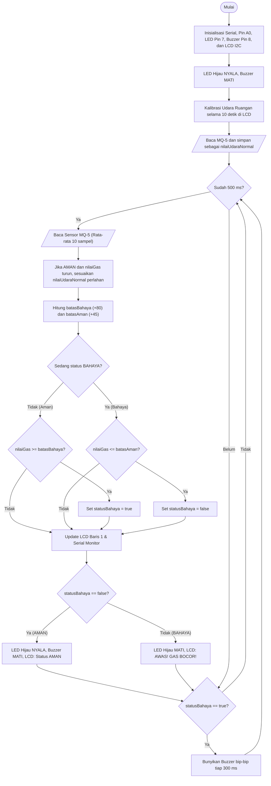

# Detektor Kebocoran Gas Berbasis Arduino UNO & Sensor MQ-5

Panduan lengkap langkah demi langkah (*step-by-step*) untuk merakit, memprogram, mengkalibrasi, menguji, dan memperbaiki proyek **Detektor Kebocoran Gas** menggunakan **Arduino UNO**, **Sensor Gas MQ-5**, **LCD I2C 16×2**, **LED Hijau**, dan **Buzzer 5V**.

Sistem ini dirancang untuk mendeteksi kebocoran gas yang mudah terbakar (seperti LPG, gas alam, butana/gas mancis) serta uap alkohol/parfum, lalu memberikan peringatan visual dan suara secara otomatis.

> **Catatan Konsep:** Proyek dasar ini menggunakan Arduino UNO sehingga secara teknis merupakan **sistem mikrokontroler (*embedded system*)**. Untuk menjadikannya sistem **IoT (*Internet of Things*)** penuh, proyek dapat dikembangkan lebih lanjut menggunakan ESP8266/ESP32 agar terhubung ke internet (lihat bagian [Pengembangan Lanjutan](#8-pengembangan-lanjutan-menuju-iot-penuh)).

---

## Daftar Isi

1. [Fitur Utama](#1-fitur-utama)
2. [Alat dan Bahan](#2-alat-dan-bahan)
3. [Flowchart Cara Kerja Sistem](#3-flowchart-cara-kerja-sistem)
4. [Panduan Pengerjaan Step-by-Step](#4-panduan-pengerjaan-step-by-step)
   - [Tahap 1: Persiapan Software & Library](#tahap-1-persiapan-software--library)
   - [Tahap 2: Upload Kode Saat Arduino Masih Kosong](#tahap-2-upload-kode-saat-arduino-masih-kosong)
   - [Tahap 3: Skema Pengkabelan (Wiring)](#tahap-3-skema-pengkabelan-wiring)
   - [Tahap 4: Perakitan Komponen Secara Bertahap](#tahap-4-perakitan-komponen-secara-bertahap)
5. [Kode Program Lengkap](#5-kode-program-lengkap)
6. [Cara Penggunaan & Pengujian Alat](#6-cara-penggunaan--pengujian-alat)
7. [Troubleshooting (Solusi Masalah Umum)](#7-troubleshooting-solusi-masalah-umum)
8. [Pengembangan Lanjutan Menuju IoT Penuh](#8-pengembangan-lanjutan-menuju-iot-penuh)

---

## 1. Fitur Utama

- **Auto-Kalibrasi Udara Ruangan:** Saat alat dinyalakan, sistem melakukan kalibrasi selama 10 detik dan menjadikan kondisi udara ruangan sebagai patokan normal sehingga alat **langsung mulai dari `Status: AMAN`** tanpa alarm palsu.
- **Pelacakan Baseline Otomatis:** Jika sensor MQ-5 semakin hangat dan angka udara bersihnya perlahan turun, nilai patokan normal akan otomatis menyesuaikan.
- **Filter Rata-Rata & Histeresis:** Membaca rata-rata 10 sampel untuk meredam gangguan sinyal (*noise*) serta memakai ambang histeresis (`+80` masuk BAHAYA, `+45` kembali AMAN) agar LCD, LED, dan buzzer tidak berkedip cepat di angka perbatasan.
- **Auto-Deteksi LCD I2C (`hd44780`):** Otomatis mendeteksi alamat I2C (`0x27` / `0x3F`) dan susunan pin modul backpack LCD sehingga mencegah tampilan huruf acak atau layar berkedip.
- **Alarm Non-Blocking (`millis`):** Buzzer berbunyi *bip-bip* tiap 300 ms saat kondisi bahaya untuk mengurangi lonjakan arus dan mendukung **Buzzer Aktif 5V** maupun **Buzzer Pasif**.

---

## 2. Alat dan Bahan

| No | Komponen | Jumlah | Spesifikasi / Keterangan Penting |
| :-: | :--- | :-: | :--- |
| 1 | **Arduino UNO R3** | 1 buah | Beserta kabel data USB Type-B (pastikan kabel data, bukan kabel daya saja) |
| 2 | **Sensor Gas MQ-5** | 1 buah | Modul 4 pin (`VCC`, `GND`, `DO`, `AO`) — peka terhadap LPG, gas alam, butana, dan uap alkohol |
| 3 | **LCD 16×2 + Modul I2C** | 1 buah | Layar 16 kolom × 2 baris dengan backpack I2C PCF8574 (`VCC`, `GND`, `SDA`, `SCL`) |
| 4 | **LED Hijau (5 mm)** | 1 buah | Indikator kondisi **AMAN** (menyala saat tidak ada kebocoran gas) |
| 5 | **Resistor 220Ω atau 330Ω** | 1 buah | **Wajib dipasang seri pada LED Hijau** agar LED tidak putus dan Arduino tidak restart |
| 6 | **Buzzer 5V** *(opsional)* | 1 buah | Alarm suara kondisi **BAHAYA** (mendukung buzzer aktif 2-kaki, modul 3-pin, atau pasif) |
| 7 | **Breadboard** | 1 buah | Ukuran 400 atau 830 titik untuk membagi jalur `5V`, `GND`, dan memasang LED/resistor |
| 8 | **Kabel Jumper** | ±15 buah | Kombinasi *Male-to-Male* dan *Male-to-Female* |
| 9 | **Laptop / PC** | 1 unit | Terpasang **Arduino IDE** (disarankan versi 2.x) |

> **Peringatan Sumber Daya:** Gunakan **kabel USB laptop** atau **adaptor 5V minimal 1A–2A**. **Jangan gunakan baterai kotak 9V** karena arusnya terlalu kecil untuk menyuplai sensor MQ-5 (~160 mA) + LCD I2C + LED + Buzzer secara bersamaan (akan menyebabkan Arduino terus restart).

---

## 3. Flowchart Cara Kerja Sistem



---

## 4. Panduan Pengerjaan Step-by-Step

Ikuti urutan langkah berikut secara berurutan agar terhindar dari gagal upload, korsleting, atau layar LCD berkedip.

### Tahap 1: Persiapan Software & Library

1. Unduh dan pasang **Arduino IDE** dari situs resmi Arduino (`arduino.cc`).
2. Buka Arduino IDE, lalu buka menu **Library Manager** (ikon tumpukan buku di sisi kiri, atau tekan `Ctrl + Shift + I`).
3. Pada kolom pencarian, ketik **`hd44780`**.
4. Cari library **`hd44780` by Bill Perry**, lalu klik **INSTALL**.
   - *Mengapa memakai `hd44780`?* Library ini otomatis mendeteksi alamat I2C (`0x27` atau `0x3F`) serta urutan pin modul I2C sehingga jauh lebih stabil dibanding `LiquidCrystal_I2C` biasa.
5. *(Khusus pengguna Arduino UNO Clone dengan chip CH340)* Jika nanti Port COM tidak terdeteksi di Windows (*Device Manager → Ports*), pasang driver **CH340/CH341** terlebih dahulu.

---

### Tahap 2: Upload Kode Saat Arduino Masih Kosong

> **Sangat Disarankan:** Upload kode **sebelum** kabel sensor, LCD, LED, dan buzzer dipasang ke Arduino UNO. Ini mencegah error `programmer is not responding` akibat beban daya atau kabel yang mengganggu pin `0 (RX)` / `1 (TX)`.

1. Hubungkan **Arduino UNO kosong** ke laptop menggunakan kabel USB. Pastikan lampu **`ON`** di papan Arduino menyala.
2. Di Arduino IDE, buka file `detektor_gas_mq5/detektor_gas_mq5.ino` (atau salin kode dari [Bagian 5](#5-kode-program-lengkap)).
3. Pilih board: **`Tools → Board → Arduino AVR Boards → Arduino Uno`**.
4. Pastikan memilih Port COM yang benar:
   - Cabut USB sebentar → cek daftar **`Tools → Port`**.
   - Colok USB lagi → cek **`Tools → Port`** → pilih **`COM...`** yang **baru muncul**.
5. Pastikan tab **Serial Monitor** dalam keadaan tertutup.
6. Klik tombol **Upload (`→`)**. Perhatikan lampu **`RX`** dan **`TX`** di Arduino akan berkedip, lalu tunggu hingga muncul tulisan **`Done uploading.`**.
7. Setelah selesai upload, **cabut kabel USB dari laptop** sebelum mulai merakit kabel.

---

### Tahap 3: Skema Pengkabelan (Wiring)

Pertama, hubungkan pin **`5V`** Arduino ke jalur **`+` (merah)** breadboard dan pin **`GND`** Arduino ke jalur **`-` (biru)** breadboard agar semua komponen mendapatkan daya dan *common ground* yang sama.

> **Hati-hati pada Breadboard Panjang (830 titik):** Jalur `+` dan `-` di bagian pinggir breadboard panjang sering **terputus di bagian tengah**. Pastikan semua kabel `5V` dan `GND` ditancapkan di sisi yang sama, atau sambungkan bagian kiri dan kanan dengan kabel jumper pendek.

#### Tabel Koneksi Pin Lengkap (Arduino UNO)

| Komponen | Pin Komponen | Hubungkan Ke | Catatan Penting |
| :--- | :--- | :--- | :--- |
| **LCD I2C 16×2** | `VCC` | Jalur **`5V`** breadboard | Wajib 5V agar kontras terang |
| | `GND` | Jalur **`GND`** breadboard | *Common ground* |
| | `SDA` | Pin **`A4`** Arduino | Jalur data I2C (jangan tertukar dengan `SCL`) |
| | `SCL` | Pin **`A5`** Arduino | Jalur clock I2C |
| **Sensor MQ-5** | `VCC` | Jalur **`5V`** breadboard | Wajib 5V untuk pemanas internal |
| | `GND` | Jalur **`GND`** breadboard | Jika kendor, nilai sensor akan mentok `>850` |
| | `AO` | Pin **`A0`** Arduino | **Wajib pin `AO` (Analog), BUKAN `DO`!** |
| | `DO` | *(tidak dipakai)* | Biarkan kosong |
| **LED Hijau** | Kaki panjang (`+` / Anoda) | Pin **`7`** *(lewat Resistor 220Ω–330Ω)* | **Jangan tanpa resistor!** |
| | Kaki pendek (`-` / Katoda) | Jalur **`GND`** breadboard | Sisi datar pada kepala LED = kutub negatif |
| **Buzzer 5V (2 Kaki)** | Kaki panjang (`+`) | Pin **`8`** Arduino | Jangan hubungkan kaki `+` ke `5V` |
| | Kaki pendek (`-`) | Jalur **`GND`** breadboard | *Common ground* |
| **Modul Buzzer (3 Pin)** *(jika pakai modul)* | `VCC` | Jalur **`5V`** breadboard | Suplai modul |
| | `GND` | Jalur **`GND`** breadboard | *Common ground* |
| | `I/O` / `S` / `SIG` | Pin **`8`** Arduino | Sinyal kontrol |

#### Detail Pemasangan LED Hijau + Resistor di Breadboard

```text
Pin 7 Arduino ---> [ Resistor 220Ω atau 330Ω ] ---> (+) Kaki Panjang LED Hijau (-) ---> GND
```

- Pastikan **kaki panjang (`+`)** dan **kaki pendek (`-`)** LED menancap pada **baris lubang breadboard yang berbeda** agar tidak korsleting (*short circuit*).

---

### Tahap 4: Perakitan Komponen Secara Bertahap

> **Aturan Keselamatan Perakitan:** Setiap kali akan mencolok atau memindahkan kabel jumper, **cabut kabel USB dari laptop terlebih dahulu**, lalu colok kembali untuk mengetes.

1. **Tahap A — Pasang LCD I2C saja dulu:**
   - Sambungkan `VCC`, `GND`, `SDA (A4)`, dan `SCL (A5)`.
   - Colok USB → LCD harus menyala, menampilkan **`Kalibrasi Udara`** selama 10 detik, lalu masuk tampilan **`Gas MQ5: ...`** tanpa restart atau huruf acak.
   - *Jika layar menyala tapi tulisan tidak tampak*, putar **potensiometer biru** di bagian belakang modul I2C perlahan dengan obeng kecil sampai teks terlihat jelas.

2. **Tahap B — Tambahkan Sensor MQ-5:**
   - Cabut USB → sambungkan `VCC` (`5V`), `GND` (`GND`), dan **`AO` (`A0`)**.
   - Colok USB → tunggu kalibrasi 10 detik selesai. Angka `Gas MQ5` akan tampil dan status langsung **`Status: AMAN`**.
   - Setelah 1–2 menit menyala, jaring besi MQ-5 akan terasa **hangat** (ini **normal** karena ada elemen pemanas di dalamnya).

3. **Tahap C — Tambahkan LED Hijau + Resistor:**
   - Cabut USB → pasang Pin `7` → Resistor `220Ω–330Ω` → LED Hijau (`+`) dan LED (`-`) → `GND`.
   - Colok USB → LED Hijau harus langsung menyala terang selama kondisi **`Status: AMAN`** dan LCD tetap stabil (tidak restart).

4. **Tahap D — Tambahkan Buzzer 5V:**
   - Cabut USB → pasang Buzzer ke Pin `8` dan `GND` (serta `5V` jika memakai modul buzzer 3 pin).
   - Colok USB → sistem siap diuji!

---

## 5. Kode Program Lengkap

Kode sumber tersedia di [`detektor_gas_mq5/detektor_gas_mq5.ino`](detektor_gas_mq5/detektor_gas_mq5.ino):

```cpp
#include <Wire.h>
#include <hd44780.h>
#include <hd44780ioClass/hd44780_I2Cexp.h>

hd44780_I2Cexp lcd; // Otomatis mendeteksi alamat I2C & pin backpack LCD

// --- PENGATURAN PIN (ARDUINO UNO) ---
const int PIN_MQ5       = A0; // Pin AO sensor MQ-5
const int PIN_LED_HIJAU = 7;  // LED Hijau (+ resistor 220-330 Ohm)
const int PIN_BUZZER    = 8;  // Buzzer 5V

// --- PENGATURAN SENSITIVITAS & BUZZER ---
const bool PAKAI_BUZZER    = true; // Ubah ke false jika tidak memasang buzzer
const bool BUZZER_AKTIF    = true; // true = Buzzer Aktif 5V, false = Buzzer Pasif
const int  SELISIH_BAHAYA  = 80;   // Masuk BAHAYA jika angka naik +80 dari udara normal
const int  SELISIH_AMAN    = 45;   // Kembali AMAN jika turun ke +45 dari udara normal
const int  DETIK_KALIBRASI = 10;   // Durasi kalibrasi udara awal (detik)

// --- VARIABEL INTERNAL ---
int  nilaiUdaraNormal     = 300;
bool statusBahaya         = false;
int  nilaiGasTerakhir     = -1;
int  statusTerakhir       = -1;
bool bunyiBuzzer          = false;
unsigned long waktuBaca   = 0;
unsigned long waktuBuzzer = 0;

int bacaSensorMQ5() {
  long total = 0;
  for (int i = 0; i < 10; i++) {
    total += analogRead(PIN_MQ5);
    delay(5);
  }
  return (int)(total / 10);
}

void matikanBuzzer() {
  if (!PAKAI_BUZZER) return;
  if (BUZZER_AKTIF) {
    digitalWrite(PIN_BUZZER, LOW);
  } else {
    noTone(PIN_BUZZER);
  }
  bunyiBuzzer = false;
}

void nyalakanBuzzer() {
  if (!PAKAI_BUZZER) return;
  if (BUZZER_AKTIF) {
    digitalWrite(PIN_BUZZER, HIGH);
  } else {
    tone(PIN_BUZZER, 1000);
  }
  bunyiBuzzer = true;
}

void setup() {
  Serial.begin(9600);

  pinMode(PIN_MQ5, INPUT);
  pinMode(PIN_LED_HIJAU, OUTPUT);
  if (PAKAI_BUZZER) {
    pinMode(PIN_BUZZER, OUTPUT);
  }

  // Mulai langsung dalam kondisi AMAN
  digitalWrite(PIN_LED_HIJAU, HIGH);
  matikanBuzzer();

  lcd.begin(16, 2);
  Wire.setClock(50000); // Kecepatan I2C 50 kHz agar tahan gangguan kabel jumper
  lcd.backlight();

  // Pemanasan singkat & kalibrasi udara ruangan otomatis
  lcd.setCursor(0, 0);
  lcd.print("Kalibrasi Udara ");
  for (int detik = DETIK_KALIBRASI; detik > 0; detik--) {
    lcd.setCursor(0, 1);
    lcd.print("Tunggu: ");
    if (detik < 10) lcd.print(" ");
    lcd.print(detik);
    lcd.print(" dtk  ");
    delay(1000);
  }

  // Rekam nilai udara bersih saat ini sebagai patokan normal
  nilaiUdaraNormal = bacaSensorMQ5();
  if (nilaiUdaraNormal > 900) {
    nilaiUdaraNormal = 900;
  }

  lcd.clear();
  Serial.print(F("Patokan Udara Normal: "));
  Serial.println(nilaiUdaraNormal);
}

void loop() {
  unsigned long sekarang = millis();

  if (sekarang - waktuBaca >= 500) {
    waktuBaca = sekarang;

    int nilaiGas = bacaSensorMQ5();

    // Jika sensor makin hangat dan angka udara bersih turun, ikuti perlahan
    if (!statusBahaya && nilaiGas > 50 && nilaiGas < nilaiUdaraNormal) {
      nilaiUdaraNormal--;
    }

    int batasBahaya = nilaiUdaraNormal + SELISIH_BAHAYA;
    int batasAman   = nilaiUdaraNormal + SELISIH_AMAN;
    if (batasBahaya > 1000) batasBahaya = 1000;
    if (batasAman > 960)    batasAman   = 960;

    // Evaluasi status AMAN vs BAHAYA (dengan histeresis)
    if (!statusBahaya && nilaiGas >= batasBahaya) {
      statusBahaya = true;
    } else if (statusBahaya && nilaiGas <= batasAman) {
      statusBahaya = false;
    }

    // Kirim data ke Serial Monitor untuk pemantauan & kalibrasi
    Serial.print(F("Gas: "));
    Serial.print(nilaiGas);
    Serial.print(F(" | Batas: "));
    Serial.print(batasBahaya);
    Serial.print(F(" | "));
    Serial.println(statusBahaya ? F("BAHAYA") : F("AMAN"));

    // Update baris 1 LCD hanya saat angka berubah
    if (nilaiGas != nilaiGasTerakhir) {
      lcd.setCursor(0, 0);
      lcd.print("Gas MQ5: ");
      lcd.print(nilaiGas);
      if (nilaiGas < 10)        lcd.print("      ");
      else if (nilaiGas < 100)  lcd.print("     ");
      else if (nilaiGas < 1000) lcd.print("    ");
      else                      lcd.print("   ");
      nilaiGasTerakhir = nilaiGas;
    }

    // Update baris 2 LCD & LED Hijau hanya saat status berubah
    if ((int)statusBahaya != statusTerakhir) {
      lcd.setCursor(0, 1);
      if (!statusBahaya) {
        digitalWrite(PIN_LED_HIJAU, HIGH);
        matikanBuzzer();
        lcd.print("Status: AMAN    ");
      } else {
        digitalWrite(PIN_LED_HIJAU, LOW);
        lcd.print("AWAS! GAS BOCOR!");
      }
      statusTerakhir = (int)statusBahaya;
    }
  }

  // Alarm bip-bip tiap 300 ms saat BAHAYA
  if (statusBahaya && PAKAI_BUZZER) {
    if (sekarang - waktuBuzzer >= 300) {
      waktuBuzzer = sekarang;
      if (bunyiBuzzer) {
        matikanBuzzer();
      } else {
        nyalakanBuzzer();
      }
    }
  }
}
```

### Parameter yang Dapat Disesuaikan

| Variabel | Nilai Default | Fungsi |
| :--- | :---: | :--- |
| `PAKAI_BUZZER` | `true` | Ubah ke `false` jika rangkaian tidak memakai buzzer |
| `BUZZER_AKTIF` | `true` | Ubah ke `false` jika buzzer tidak bunyi / hanya bunyi *"tik-tik"* (buzzer pasif) |
| `SELISIH_BAHAYA` | `80` | Kecilkan ke `50` agar lebih sensitif, atau naikkan ke `120` jika terlalu sensitif |
| `SELISIH_AMAN` | `45` | Selalu buat lebih kecil dari `SELISIH_BAHAYA` (selisih ±30–40 poin) |
| `DETIK_KALIBRASI` | `10` | Bisa dinaikkan ke `20` atau `30` agar sensor lebih hangat sebelum kalibrasi |

---

## 6. Cara Penggunaan & Pengujian Alat

### Prosedur Menyalakan Alat
1. Letakkan alat di ruangan berudara bersih (jauh dari gas, parfum, alkohol, atau asap solder).
2. Hubungkan Arduino UNO ke sumber daya 5V (USB laptop atau adaptor 5V).
3. Tunggu hitungan mundur **`Kalibrasi Udara`** selama 10 detik selesai.
4. Alat siap bekerja dalam kondisi **`Status: AMAN`** (LED Hijau menyala, Buzzer mati). *(Untuk sensor MQ-5 baru pertama kali dinyalakan, biarkan hangat 3–5 menit agar responsnya paling optimal.)*

### Tabel Indikator Status Sistem

| Kondisi | Baris 1 LCD | Baris 2 LCD | LED Hijau | Buzzer |
| :--- | :--- | :--- | :---: | :---: |
| **Kalibrasi Awal** | `Kalibrasi Udara` | `Tunggu: 10 dtk` | Menyala | Mati |
| **Normal / Aman** | `Gas MQ5: 250` | `Status: AMAN` | **Menyala** | **Mati** |
| **Gas Bocor / Bahaya** | `Gas MQ5: 620` | `AWAS! GAS BOCOR!` | **Mati** | **Bunyi *bip-bip*** |

### Cara Menguji Sensor dengan Aman
1. **Menggunakan Mancis (Korek Api Gas):**
   - Dekatkan ujung mancis berjarak ±2 cm ke jaring besi MQ-5.
   - Tekan tuas gasnya saja selama 1–2 detik **TANPA menyalakan apinya**.
2. **Pengganti Tanpa Mancis (Parfum / *Hand Sanitizer* / Spidol):**
   - Semprotkan sedikit parfum atau teteskan *hand sanitizer* (alkohol 70%) pada **tisu/kertas**, lalu dekatkan tisu tersebut ±1–2 cm di depan jaring sensor.
   - Alternatif lain: buka tutup **spidol papan tulis (*boardmarker*)** dan dekatkan ujungnya ±1 cm di depan sensor.
   - **Larangan:** Jangan menyemprotkan cairan langsung ke jaring sensor dan jangan menyentuh jaring besi sensor dengan jari (keringat/minyak kulit bisa mengacaukan pembacaan).
3. **Pemantauan Detail (Opsional):**
   - Buka **Serial Monitor** di Arduino IDE pada **`9600 baud`** untuk melihat nilai `Gas`, nilai `Batas` dinamis, dan status secara *real-time*.

---

## 7. Troubleshooting (Solusi Masalah Umum)

| Gejala / Error | Penyebab Utama | Solusi |
| :--- | :--- | :--- |
| **`Error: programmer is not responding`** / **`not in sync: resp=0x00`** | Port COM salah pilih, pin `0 (RX)` / `1 (TX)` terpakai, rangkaian menyedot arus saat upload, atau driver CH340 belum terpasang | 1. Cabut sementara kabel `5V` dan `GND` dari Arduino ke breadboard saat upload.<br>2. Cabut-colok USB lalu pilih COM yang baru muncul di `Tools → Port`.<br>3. Tutup Serial Monitor.<br>4. Coba **Manual Reset** (tahan tombol Reset → klik Upload → lepas Reset tepat saat muncul `Uploading...`).<br>5. Coba ganti kabel USB atau pindah lubang USB. |
| **LCD menyala, tetapi kosong / hanya kotak putih** | Kontras LCD belum diatur | Putar **potensiometer biru** di bagian belakang modul I2C perlahan dengan obeng kecil. |
| **LCD kedap-kedip & huruf acak tidak beraturan** | Library tidak cocok dengan pin modul I2C, kabel `SDA`/`SCL`/`GND` longgar, atau tegangan 5V drop | 1. Pastikan menggunakan library **`hd44780` by Bill Perry**.<br>2. Rapatkan/ganti kabel jumper `SDA (A4)`, `SCL (A5)`, `VCC`, `GND`.<br>3. Cek solderan 16 pin antara LCD dan modul I2C.<br>4. Gunakan suplai USB/adaptor 5V yang stabil. |
| **LCD terus mengulang hitungan mundur (Arduino restart terus)** | Tegangan 5V drop (*brown-out*) saat LED atau Buzzer menyala, atau LED korsleting | 1. Pastikan LED Hijau **memakai Resistor 220Ω–330Ω** dan kedua kakinya di baris breadboard berbeda.<br>2. Jangan gunakan baterai kotak 9V.<br>3. Pastikan kaki `+` buzzer 2-kaki terhubung ke Pin `8` (bukan `5V`). |
| **Angka `Gas MQ5` diam terus di atas `850–1023`** | Kabel `GND` MQ-5 lepas/terputus di tengah breadboard, atau salah colok ke pin `DO` | 1. Sentuh pelan jaring MQ-5: jika dingin, berarti `VCC`/`GND` belum tersambung.<br>2. Pastikan kabel ke `A0` tercolok di pin **`AO`** (bukan `DO`).<br>3. Jauhkan uap alkohol, parfum, dan asap solder dari meja. |
| **LCD sudah `AWAS! GAS BOCOR!`, tetapi buzzer diam / bunyi *"tik-tik"* pelan** | Jenis buzzer yang dipakai adalah Buzzer Pasif | Ubah `const bool BUZZER_AKTIF = true;` menjadi `false;` lalu upload ulang. |
| **Bodi sensor MQ-5 terasa hangat/panas** | Elemen pemanas internal aktif | **Normal.** Jangan ditutup rapat dan hindari menyentuh jaring logam secara langsung. |

---

## 8. Pengembangan Lanjutan Menuju IoT Penuh

Jika ingin mengembangkan proyek ini agar benar-benar terhubung ke internet (**IoT**):

1. **Ganti Mikrokontroler ke ESP8266 (NodeMCU) atau ESP32:**
   - **Perhatian Tegangan:** Output `AO` MQ-5 dapat mencapai **5V**, sedangkan pin analog ESP8266/ESP32 hanya aman hingga **3.3V** (atau 1V pada ADC mentah ESP8266). Wajib tambahkan rangkaian pembagi tegangan (*voltage divider*, misalnya resistor `10 kΩ` dan `20 kΩ`) pada jalur `AO` sebelum masuk ke pin analog ESP agar board tidak rusak.
   - Sesuaikan nomor pin I2C (`SDA`/`SCL`) dan rentang ADC ESP32 (`0–4095`).
2. **Tambahkan Notifikasi & Kontrol Otomatis:**
   - Kirim peringatan kebocoran gas secara *real-time* ke **Telegram Bot**, **WhatsApp**, atau dashboard **Blynk**.
   - Tambahkan modul **Relay 5V** untuk menyalakan **kipas *exhaust*** otomatis ketika kebocoran gas terdeteksi.

---

> **Peringatan Keselamatan:** Proyek ini adalah prototipe edukasi dan **tidak dimaksudkan** menggantikan detektor gas tersertifikasi SNI/industri untuk keselamatan jiwa di lingkungan berisiko tinggi. Jangan pernah menguji sensor dengan api terbuka.
